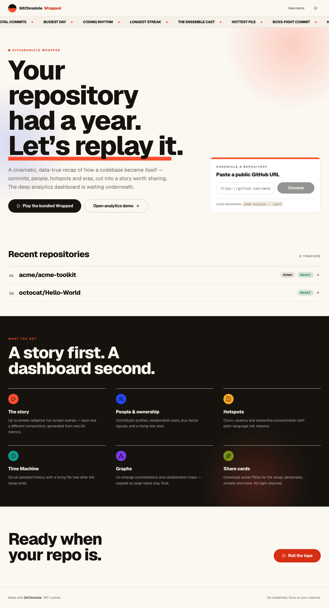
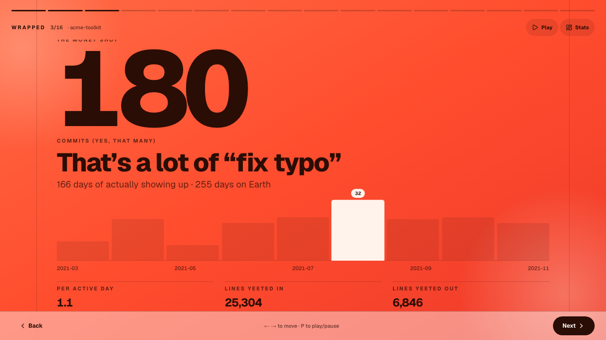
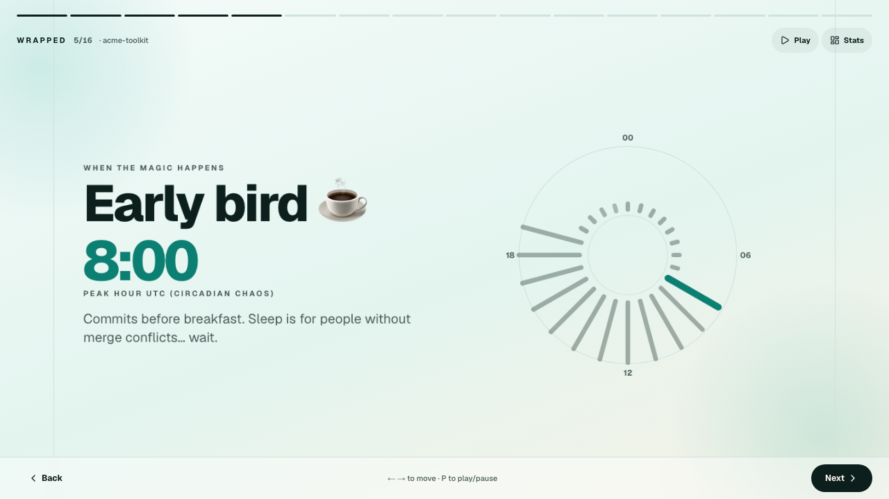
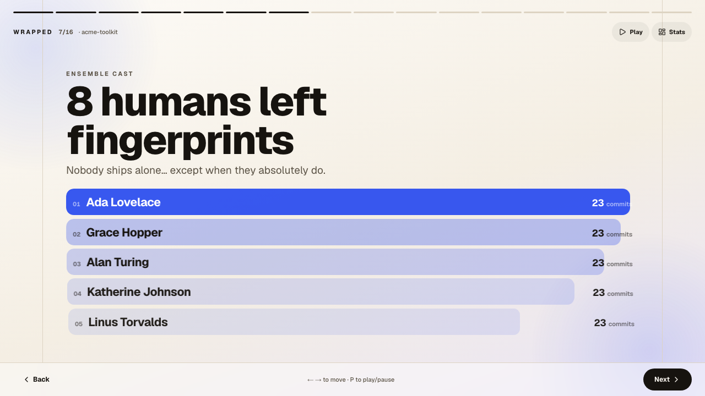
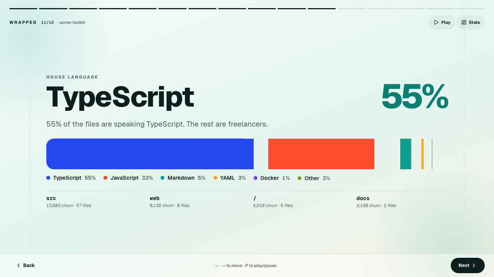
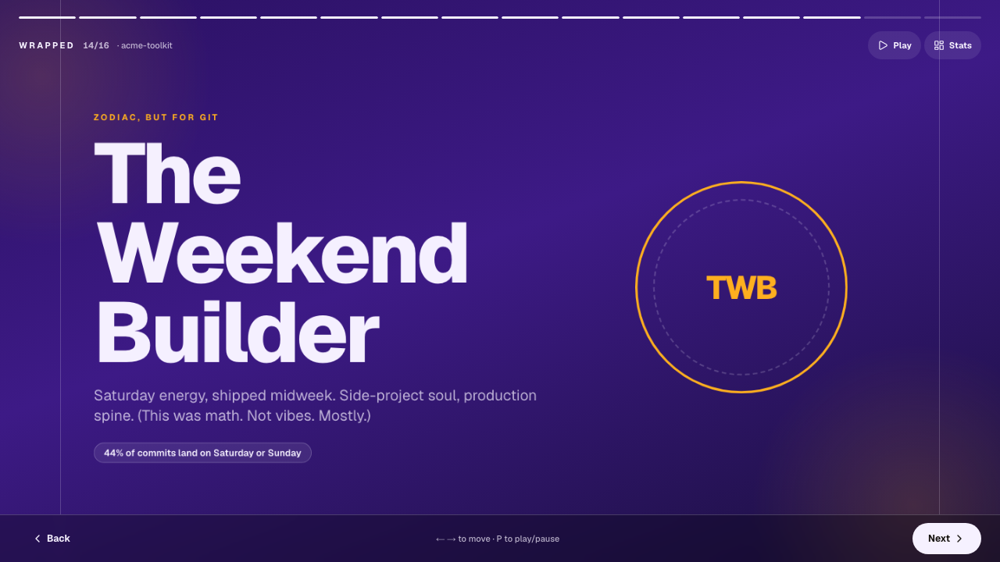
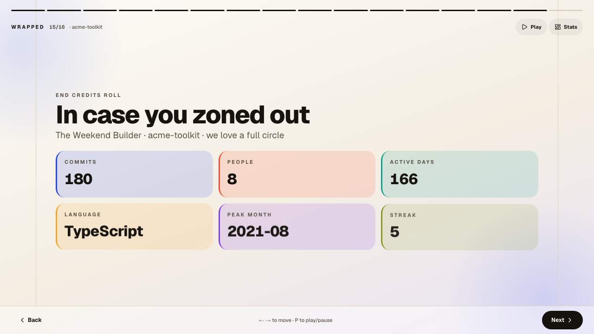
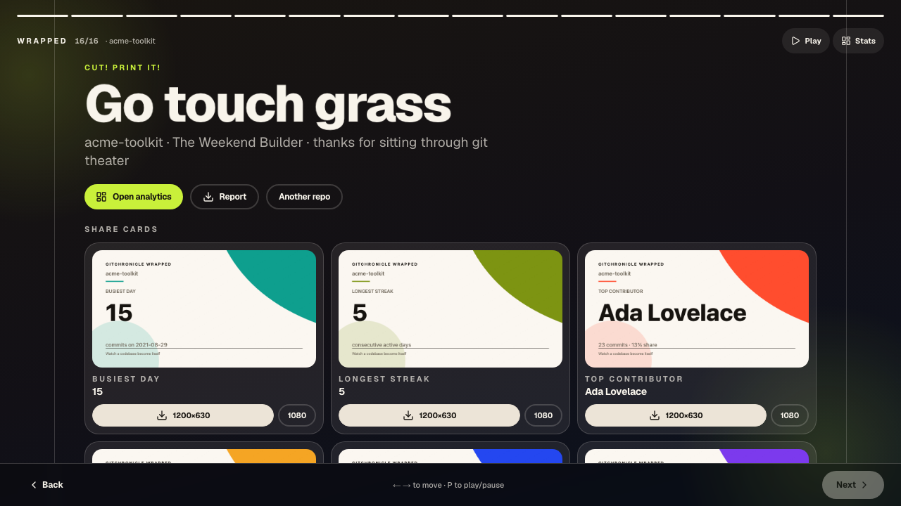
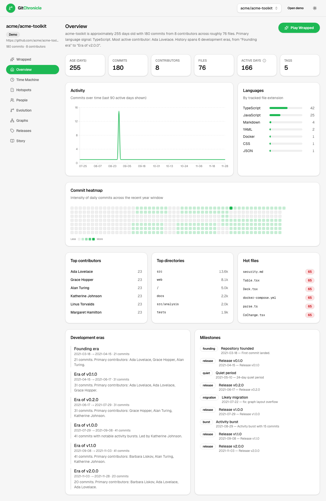
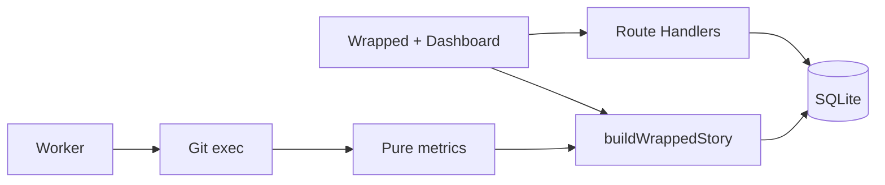

# GitChronicle Wrapped

**Your repository had a year. Let’s replay it.**

GitChronicle turns a Git repository into a cinematic, shareable recap — then a deep engineering-intelligence dashboard. Import a public GitHub URL, analyze a local repo, or open the bundled demo.

[](https://github.com/erikkostashuk/gitchronicle/actions/workflows/ci.yml)  

### ▶ [Try the live demo](https://gitchronicle.up.railway.app)

No sign-up, no API key. Open the bundled demo story, or paste a public GitHub
URL and watch a real repository get analysed.



## Features

- **Wrapped** — up to 16 adaptive full-screen scenes, each with its own composition: personality, streaks, people, plot twists, share cards
- **Overview** — age, commits, heatmap, eras, narrative
- **Time Machine** — play / scrub sampled history
- **Hotspots** — churn, ownership, bus-factor
- **People** — profiles, hours, collaboration
- **Evolution** — growth, bursts, quiet periods
- **Graphs** — co-change & collaboration (capped)
- **Releases** — tags + Markdown notes
- **Exports** — PNG social cards + Markdown repository report

Everything is computed from Git history alone, deterministically. **No external
service, no account, no API keys** — the same repository always produces the
same result.

## Limitations

Worth knowing before you invest time:

- **Public HTTPS GitHub URLs only** for remote import. Private repositories,
  other hosts (GitLab, Bitbucket), and SSH remotes aren't supported — clone them
  yourself and use `pnpm analyze` instead.
- **Needs a writable disk and the `git` binary**, so serverless platforms are out.
  It wants a small container with a volume.
- **One replica.** SQLite plus a single attached volume doesn't scale
  horizontally, and rate limiting is in-process.
- **Large repositories are bounded, not streamed.** Analysis stops at
  `MAX_COMMITS` (default 50,000); clones over `MAX_CLONE_SIZE_MB` are rejected
  rather than partially processed. A very large monorepo will be truncated.
- **Identity is taken at face value** from Git metadata — someone committing
  under several emails shows up as several people unless `.mailmap` resolves them.
- **Analysis is a snapshot**, not a live feed. Re-import to refresh.
- **Everything on an instance is public to everyone on it.** There are no
  accounts and no per-repository access control.
- **Imports are ephemeral.** Only the newest `MAX_STORED_PROJECTS` (default 5)
  are kept; older ones are evicted along with their analyses and clones. Raise
  it on your own instance if you want a longer history.

## The Wrapped story

Every beat is a different layout, not one template with swapped numbers — a
colossal numeral for the headline, a 24-hour radial dial for rhythm, a ranked
ensemble for contributors, a proportional colour field for languages, and a
share-card wall to close. Light warm-paper scenes carry the story, punctuated by
a few deliberately dark beats.

| | |
| --- | --- |
|  |  |
|  |  |
|  |  |

Autoplay, keyboard (`← →`, `Home`/`End`, `P`), tap-the-edges and swipe all
navigate. `prefers-reduced-motion` keeps every end state and drops the movement.



## Dashboard



## Requirements

| | |
| --- | --- |
| **Node.js** | 22 or newer (`node -v`) |
| **pnpm** | 10 or newer — `corepack enable && corepack prepare pnpm@10.14.0 --activate` |
| **git** | On `PATH` — the analysis engine shells out to it |
| **Disk** | A writable data directory for SQLite and clones |

No database server, no API keys, no accounts.

## Sixty-second local setup

```bash
git clone https://github.com/erikkostashuk/gitchronicle.git
cd gitchronicle
pnpm install
cp .env.example .env
pnpm db:migrate   # creates data/gitchronicle.db
pnpm seed         # loads the bundled Acme Toolkit demo project
pnpm dev
```

Open [http://localhost:3000](http://localhost:3000) → **Play bundled Wrapped**.

Everything in `.env.example` has a working default, so `cp .env.example .env` is
enough — the file exists so you have something to tune later. Missing or invalid
variables fail fast at startup with the offending key named
(`src/lib/env.ts`).

**Database.** SQLite at `$DATA_DIR/gitchronicle.db` (default `./data`).
`pnpm db:migrate` is idempotent — run it after every pull. `pnpm seed` is also
idempotent; it builds the demo project from a deterministic generator in code
(`src/lib/demo/generate.ts`), so seeding needs no network and no downloaded
fixture. To start over, delete `data/gitchronicle.db*` and re-run both.

Nothing under `data/` is tracked in Git — it is entirely runtime state that
`pnpm db:migrate && pnpm seed` recreates.

## Environment variables

Every variable is optional and has the default shown. Copy `.env.example` and
change only what you need.

**Core**

| Variable | Default | Purpose |
| --- | --- | --- |
| `NODE_ENV` | `development` | Standard Node environment |
| `PORT` | `3000` | HTTP port. Container hosts inject this — don't set it there |
| `DATA_DIR` | `./data` | SQLite database, clones, and temp files. Absolute or project-relative |
| `DATABASE_URL` | `$DATA_DIR/gitchronicle.db` | Override the SQLite file path only |
| `APP_URL` | *(unset)* | Public origin for canonical and Open Graph URLs. Set when deploying |
| `LOG_LEVEL` | `info` | `debug` \| `info` \| `warn` \| `error` |

**Analysis limits** — raise for big repositories, lower for small hosts.

| Variable | Default | Purpose |
| --- | --- | --- |
| `MAX_COMMITS` | `50000` | Commits analysed before truncation |
| `MAX_CLONE_SIZE_MB` | `500` | Per-repository clone ceiling; larger repos are rejected |
| `CLONE_TIMEOUT_MS` | `300000` | Kill a clone after 5 minutes |
| `ANALYZE_TIMEOUT_MS` | `600000` | Kill analysis after 10 minutes |
| `MAX_GRAPH_NODES` | `80` | Co-change / collaboration graph node cap |
| `MAX_GRAPH_EDGES` | `200` | Graph edge cap |
| `MAX_TIMELINE_SAMPLES` | `200` | Time Machine sample points |
| `MAX_COCHANGE_PAIRS` | `40000` | Distinct co-change pairs tracked (memory bound) |
| `MAX_COCHANGE_FILES_PER_COMMIT` | `24` | Files considered per commit when pairing |

**Public-instance abuse controls** — see [Security](#security--running-a-public-instance).

| Variable | Default | Purpose |
| --- | --- | --- |
| `MAX_CONCURRENT_ANALYSES` | `1` | Simultaneous clone+analyse jobs; excess requests get `503` |
| `IMPORT_RATE_LIMIT` | `5` | Imports per client IP per window |
| `IMPORT_RATE_WINDOW_MS` | `600000` | Rate-limit window (10 minutes) |
| `MAX_TOTAL_CLONE_MB` | `2000` | Total retained clone budget; `0` disables the check |
| `MAX_STORED_PROJECTS` | `5` | Projects kept. Imports are ephemeral — the newest survive, older ones are evicted with their analyses, jobs and clones. The demo counts toward this but is never evicted; `0` disables |
| `KEEP_CLONES` | `false` | Keep clones after analysis. Leave `false` — clones are the only unbounded disk growth |

**Container only**

| Variable | Default | Purpose |
| --- | --- | --- |
| `SKIP_SEED` | `0` | Set to `1` to stop the Docker entrypoint recreating the demo project on every boot |

Nothing here is a secret, and nothing is exposed to the browser — there are no
`NEXT_PUBLIC_*` variables.

## Docker

```bash
docker compose up --build
```

Serves on [http://localhost:3000](http://localhost:3000) with the data directory
on a named volume. The entrypoint (`scripts/docker-entrypoint.sh`) takes
ownership of the mounted volume, runs migrations, seeds the demo, then drops
privileges before starting the server — so a fresh volume produces a working
instance with no manual steps.

The compose file also starts a `worker` service sharing the same volume. It is
optional: imports are processed in-process by `POST /api/projects`, and the
worker exists to pick up recovery work. Remove it if you want a single container.

## Deploying (Railway / Fly / Render)

GitChronicle needs a **writable disk** (SQLite + repository clones) and the
**`git` binary** at runtime, so it wants a container host with a persistent
volume — not a serverless platform.

### Railway

1. **New Project → Deploy from GitHub repo** and pick this repository.
   `railway.json` selects the Dockerfile builder and the `/api/health` check.
2. **Add a volume** — Service → *Data* → **Add Volume**, mount path **`/app/data`**.
   This is required; without it every deploy loses its database and clones.
3. **Set variables** (Service → *Variables*):

   | Variable | Value | Why |
   | --- | --- | --- |
   | `DATA_DIR` | `/app/data` | Must match the volume mount path |
   | `NODE_ENV` | `production` | |
   | `APP_URL` | your public domain | Canonical + Open Graph URLs |
   | `MAX_CLONE_SIZE_MB` | `250` | Per-repository ceiling |
   | `MAX_TOTAL_CLONE_MB` | ~60% of volume size | Refuse imports before the disk fills |
   | `MAX_COMMITS` | `50000` | Analysis ceiling |

   The abuse defaults (rate limit, concurrency, clone cleanup) are safe as-is —
   see [Security & running a public instance](#security--running-a-public-instance).

   Don't set `PORT` — Railway injects it and `next start` honours it.
4. **Generate a domain** — Service → *Settings* → *Networking* → **Generate Domain**.
5. First boot runs migrations and seeds the demo project automatically
   (`scripts/docker-entrypoint.sh`), so the deployed URL works immediately.

**Keep it to one replica.** SQLite plus a single attached volume does not
support horizontal scaling; `railway.json` pins `numReplicas: 1`.

A separate `pnpm worker` service isn't needed — `POST /api/projects` processes
jobs in-process. The worker exists for local multi-process setups and recovery.

Fly.io and Render work the same way: one machine/instance, a volume mounted at
`/app/data`, and `DATA_DIR` pointed at it.

## Ingestion

1. **Demo** — `/demo` or `pnpm seed` (offline Acme Toolkit history)
2. **Local** — `pnpm analyze -- /absolute/path/to/repo` → open `/repo/<slug>/wrapped`
3. **GitHub HTTPS** — paste `https://github.com/owner/repo` on the landing page

## Architecture



| Layer | Location |
| --- | --- |
| Git parse | `src/lib/git/*` |
| Metrics | `src/lib/analysis/*` |
| Wrapped story | `src/lib/wrapped/*` |
| Player + share cards | `src/components/wrapped/*` |
| Scene layouts + palettes | `src/components/wrapped/scene-stage.tsx`, `scene-theme.ts` |
| Design tokens + motion | `src/app/globals.css` |
| Persistence | `src/lib/db/*`, `src/lib/jobs/*` |

## Design system

Light-first "warm press" theme: warm off-white paper (`--paper`), near-black ink,
and a saturated accent set (coral, cobalt, teal, amber, plum, lime) used for
large colour fields and hue-separated chart series. Tokens, typographic
primitives (`gc-display`, `gc-numeral`, `gc-eyebrow`) and the motion system
(`gc-in-*` entrances, `gc-stagger`, `gc-drift-*`, `gc-marquee`) all live in
`src/app/globals.css`; `src/lib/theme/design-system.test.ts` guards contrast,
hue separation, palette balance and reduced-motion coverage.

**Icons** — `src/app/icon.svg` is the single source of truth: the brand mark
(ink top half, coral bottom half) on a warm-paper tile, which keeps the ink
readable against dark browser chrome. `pnpm icons` rasterises it into
`favicon.ico` (16/32/48) and `apple-icon.png` (180×180); Next.js wires all three
up automatically via its file conventions.

## Personality (deterministic)

Every repository gets a personality from its own history — The Night Owl, The
Weekend Builder, The Phoenix, The Feature Factory and others. Rules live in
`src/lib/wrapped/personality.ts` and are listed in
[DECISIONS.md](./DECISIONS.md#repository-personality-deterministic-first-match-wins).
First match wins, so the same repository always gets the same answer.

## Security & running a public instance

GitChronicle stores nothing private — only analysis of public repositories — so
the threat model is **abuse and resource exhaustion**, not data theft.

**Input handling**

- Only public HTTPS `github.com` URLs; owner/repo are charset-restricted and may
  not look like a `git` option (`-upload-pack`) or a path segment (`..`)
- The clone URL is *rebuilt* from validated parts, so query strings, fragments
  and `--flag`-shaped input never reach `git`
- URLs with embedded credentials are refused rather than silently stripped
- `git` runs via argument-array `spawn` — never a shell
- Other transports (`git://`, `ssh://`, `file://`, `ext::`) and look-alike hosts
  (`github.com.evil.tld`) are rejected; covered by `src/lib/security/security.test.ts`
- Rejections return one clean sentence — never a validation-library issue dump —
  and every other failure is logged server-side behind a generic message

**Abuse controls** (tunable via env, defaults suit a small public box)

| Control | Default | Effect |
| --- | --- | --- |
| `IMPORT_RATE_LIMIT` / `IMPORT_RATE_WINDOW_MS` | 5 per 10 min per IP | Throttles `POST /api/projects` and `…/retry`; returns 429 with `Retry-After` |
| `MAX_CONCURRENT_ANALYSES` | 1 | One clone+analyse at a time; further requests get 503. Enforced in the worker, so every entry point shares the ceiling |
| `MAX_TOTAL_CLONE_MB` | 2000 | Refuses new imports once the volume budget is used |
| `MAX_CLONE_SIZE_MB` | 500 | Per-repository ceiling |
| `KEEP_CLONES` | `false` | Deletes each clone after analysis — analysis output is self-contained, and retained clones are the only unbounded growth on the volume |

Rate limiting is in-process, which is exactly as accurate as a shared store
while the app runs as one instance. If you ever scale past one replica you will
need Redis-backed limits *and* a different database.

**Headers** — CSP (`default-src 'self'`, no third-party origins),
`X-Frame-Options: DENY`, `nosniff`, `Referrer-Policy`, `Permissions-Policy`, and
HSTS in production. `X-Powered-By` is off.

**Known limitations** — the import endpoint is unauthenticated by design, so
rate limits are a speed bump, not a wall: `X-Forwarded-For` is spoofable, and a
distributed caller can still queue work. Everything anyone analyses is visible
to everyone else on the instance. If that matters, put the app behind auth or a
platform-level WAF.

## Commands

| Command | Purpose |
| --- | --- |
| `pnpm dev` | Dev server |
| `pnpm build` / `pnpm start` | Production |
| `pnpm lint` / `typecheck` / `test` / `test:e2e` | Quality |
| `pnpm db:migrate` / `seed` | DB + demo |
| `pnpm analyze -- <path>` | Local analyze |
| `pnpm worker` / `cleanup` | Jobs + cleanup |
| `pnpm screenshots` | Refresh `docs/screenshots/` (server on :3000) |
| `pnpm icons` | Rebuild `favicon.ico` + `apple-icon.png` from `src/app/icon.svg` |

## Roadmap

Not commitments — the directions worth pursuing, roughly in order of value.
[Open an issue](https://github.com/erikkostashuk/gitchronicle/issues/new/choose)
if you want one of these, or something else entirely.

**Analysis**

- `.mailmap` support so one contributor with several emails counts as one person
- Streaming `git log` parsing to lift the `MAX_COMMITS` ceiling on large monorepos
- Incremental re-analysis — fetch and process only new commits instead of recloning
- Branch and merge-pattern analysis (currently the default branch only)

**Experience**

- Year and date-range scoping, so "Wrapped" can mean an actual year
- Shareable permalinks for individual scenes
- Compare two repositories, or one repository across two periods
- More export formats (PDF report, animated share video)

**Platform**

- GitLab and Bitbucket ingestion
- Optional authentication for private repositories and private instances
- Admin view for managing and deleting stored projects
- Postgres storage option to allow more than one replica

## Project documents

| | |
| --- | --- |
| [CONTRIBUTING.md](./CONTRIBUTING.md) | Setup, structure, data flows, and how-to recipes |
| [SECURITY.md](./SECURITY.md) | Threat model, reporting, public-instance guidance |
| [CODE_OF_CONDUCT.md](./CODE_OF_CONDUCT.md) | Community standards |
| [CHANGELOG.md](./CHANGELOG.md) | Release history |
| [RELEASE_CHECKLIST.md](./RELEASE_CHECKLIST.md) | Pre-release verification steps |
| [DECISIONS.md](./DECISIONS.md) | Architectural decisions and their rationale |

## Contributing

Contributions are welcome. [CONTRIBUTING.md](./CONTRIBUTING.md) covers the
project structure, the analysis data flow, and step-by-step recipes for adding a
metric, a Wrapped scene, a migration, a test, and a visualization. By
participating you agree to the [Code of Conduct](./CODE_OF_CONDUCT.md).

## License

[MIT](./LICENSE) © Erik Kostashuk
