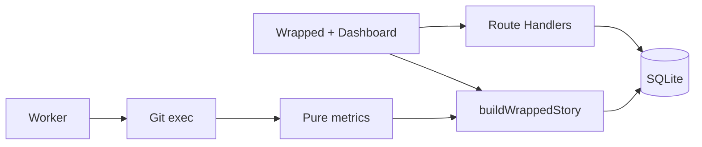

# GitChronicle Wrapped

**Your repository had a year. Let’s replay it.**

GitChronicle turns a Git repository into a cinematic, shareable recap — then a deep engineering-intelligence dashboard. Import a public GitHub URL, analyze a local repo, or open the bundled demo.

 


## Features

- **Wrapped** — up to 16 adaptive full-screen scenes, each with its own composition: personality, streaks, people, plot twists, share cards
- **Overview** — age, commits, heatmap, eras, narrative
- **Time Machine** — play / scrub sampled history
- **Hotspots** — churn, ownership, bus-factor
- **People** — profiles, hours, collaboration
- **Evolution** — growth, bursts, quiet periods
- **Graphs** — co-change & collaboration (capped)
- **Releases** — tags + Markdown notes
- **Exports** — PNG social cards + Markdown repository report

## The Wrapped story

Every beat is a different layout, not one template with swapped numbers — a
colossal numeral for the headline, a 24-hour radial dial for rhythm, a ranked
ensemble for contributors, a proportional colour field for languages, and a
share-card wall to close. Light warm-paper scenes carry the story, punctuated by
a few deliberately dark beats.

| | |
| --- | --- |
|  |  |
|  |  |
|  |  |

Autoplay, keyboard (`← →`, `Home`/`End`, `P`), tap-the-edges and swipe all
navigate. `prefers-reduced-motion` keeps every end state and drops the movement.


## Dashboard


## Sixty-second local setup

```bash
pnpm install
cp .env.example .env
pnpm db:migrate
pnpm seed
pnpm dev
```

Open [http://localhost:3000](http://localhost:3000) → **Play bundled Wrapped**.

No API keys required.

## Docker

```bash
docker compose up --build
```

## Ingestion

1. **Demo** — `/demo` or `pnpm seed` (offline Acme Toolkit history)
2. **Local** — `pnpm analyze -- /absolute/path/to/repo` → open `/repo/<slug>/wrapped`
3. **GitHub HTTPS** — paste `https://github.com/owner/repo` on the landing page

## Architecture



| Layer | Location |
| --- | --- |
| Git parse | `src/lib/git/*` |
| Metrics | `src/lib/analysis/*` |
| Wrapped story | `src/lib/wrapped/*` |
| Player + share cards | `src/components/wrapped/*` |
| Scene layouts + palettes | `src/components/wrapped/scene-stage.tsx`, `scene-theme.ts` |
| Design tokens + motion | `src/app/globals.css` |
| Persistence | `src/lib/db/*`, `src/lib/jobs/*` |

## Design system

Light-first "warm press" theme: warm off-white paper (`--paper`), near-black ink,
and a saturated accent set (coral, cobalt, teal, amber, plum, lime) used for
large colour fields and hue-separated chart series. Tokens, typographic
primitives (`gc-display`, `gc-numeral`, `gc-eyebrow`) and the motion system
(`gc-in-*` entrances, `gc-stagger`, `gc-drift-*`, `gc-marquee`) all live in
`src/app/globals.css`; `src/lib/theme/design-system.test.ts` guards contrast,
hue separation, palette balance and reduced-motion coverage.

## Personality (deterministic)

See `src/lib/wrapped/personality.ts` and [FINAL_AUDIT.md](./FINAL_AUDIT.md). Examples: The Night Owl, The Weekend Builder, The Phoenix, The Feature Factory. **No AI API.**

## Security

- Public HTTPS GitHub only for remote clone
- Argument-array `git` spawn (no shell interpolation)
- Clones under `DATA_DIR/repos/<id>`
- Timeouts and size / commit / graph caps

## Commands

| Command | Purpose |
| --- | --- |
| `pnpm dev` | Dev server |
| `pnpm build` / `pnpm start` | Production |
| `pnpm lint` / `typecheck` / `test` / `test:e2e` | Quality |
| `pnpm db:migrate` / `seed` | DB + demo |
| `pnpm analyze -- <path>` | Local analyze |
| `pnpm worker` / `cleanup` | Jobs + cleanup |
| `pnpm screenshots` | Refresh `docs/screenshots/` (server on :3000) |

## Contributing

See [CONTRIBUTING.md](./CONTRIBUTING.md). Audit notes: [FINAL_AUDIT.md](./FINAL_AUDIT.md).

## License

[MIT](./LICENSE)
