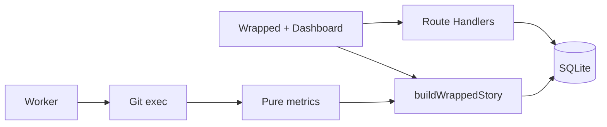

# GitChronicle Wrapped

**Your repository had a year. Let’s replay it.**

GitChronicle turns a Git repository into a cinematic, shareable recap — then a deep engineering-intelligence dashboard. Import a public GitHub URL, analyze a local repo, or open the bundled demo.

 


## Features

- **Wrapped** — up to 16 adaptive full-screen scenes, each with its own composition: personality, streaks, people, plot twists, share cards
- **Overview** — age, commits, heatmap, eras, narrative
- **Time Machine** — play / scrub sampled history
- **Hotspots** — churn, ownership, bus-factor
- **People** — profiles, hours, collaboration
- **Evolution** — growth, bursts, quiet periods
- **Graphs** — co-change & collaboration (capped)
- **Releases** — tags + Markdown notes
- **Exports** — PNG social cards + Markdown repository report

## The Wrapped story

Every beat is a different layout, not one template with swapped numbers — a
colossal numeral for the headline, a 24-hour radial dial for rhythm, a ranked
ensemble for contributors, a proportional colour field for languages, and a
share-card wall to close. Light warm-paper scenes carry the story, punctuated by
a few deliberately dark beats.

| | |
| --- | --- |
|  |  |
|  |  |
|  |  |

Autoplay, keyboard (`← →`, `Home`/`End`, `P`), tap-the-edges and swipe all
navigate. `prefers-reduced-motion` keeps every end state and drops the movement.


## Dashboard


## Sixty-second local setup

```bash
pnpm install
cp .env.example .env
pnpm db:migrate
pnpm seed
pnpm dev
```

Open [http://localhost:3000](http://localhost:3000) → **Play bundled Wrapped**.

No API keys required.

## Docker

```bash
docker compose up --build
```

## Deploying (Railway / Fly / Render)

GitChronicle needs a **writable disk** (SQLite + repository clones) and the
**`git` binary** at runtime, so it wants a container host with a persistent
volume — not a serverless platform.

### Railway

1. **New Project → Deploy from GitHub repo** and pick this repository.
   `railway.json` selects the Dockerfile builder and the `/api/health` check.
2. **Add a volume** — Service → *Data* → **Add Volume**, mount path **`/app/data`**.
   This is required; without it every deploy loses its database and clones.
3. **Set variables** (Service → *Variables*):

   | Variable | Value | Why |
   | --- | --- | --- |
   | `DATA_DIR` | `/app/data` | Must match the volume mount path |
   | `NODE_ENV` | `production` | |
   | `APP_URL` | your public domain | Canonical + Open Graph URLs |
   | `MAX_CLONE_SIZE_MB` | `250` | Per-repository ceiling |
   | `MAX_TOTAL_CLONE_MB` | ~60% of volume size | Refuse imports before the disk fills |
   | `MAX_COMMITS` | `50000` | Analysis ceiling |

   The abuse defaults (rate limit, concurrency, clone cleanup) are safe as-is —
   see [Security & running a public instance](#security--running-a-public-instance).

   Don't set `PORT` — Railway injects it and `next start` honours it.
4. **Generate a domain** — Service → *Settings* → *Networking* → **Generate Domain**.
5. First boot runs migrations and seeds the demo project automatically
   (`scripts/docker-entrypoint.sh`), so the deployed URL works immediately.

**Keep it to one replica.** SQLite plus a single attached volume does not
support horizontal scaling; `railway.json` pins `numReplicas: 1`.

A separate `pnpm worker` service isn't needed — `POST /api/projects` processes
jobs in-process. The worker exists for local multi-process setups and recovery.

Fly.io and Render work the same way: one machine/instance, a volume mounted at
`/app/data`, and `DATA_DIR` pointed at it.

## Ingestion

1. **Demo** — `/demo` or `pnpm seed` (offline Acme Toolkit history)
2. **Local** — `pnpm analyze -- /absolute/path/to/repo` → open `/repo/<slug>/wrapped`
3. **GitHub HTTPS** — paste `https://github.com/owner/repo` on the landing page

## Architecture



| Layer | Location |
| --- | --- |
| Git parse | `src/lib/git/*` |
| Metrics | `src/lib/analysis/*` |
| Wrapped story | `src/lib/wrapped/*` |
| Player + share cards | `src/components/wrapped/*` |
| Scene layouts + palettes | `src/components/wrapped/scene-stage.tsx`, `scene-theme.ts` |
| Design tokens + motion | `src/app/globals.css` |
| Persistence | `src/lib/db/*`, `src/lib/jobs/*` |

## Design system

Light-first "warm press" theme: warm off-white paper (`--paper`), near-black ink,
and a saturated accent set (coral, cobalt, teal, amber, plum, lime) used for
large colour fields and hue-separated chart series. Tokens, typographic
primitives (`gc-display`, `gc-numeral`, `gc-eyebrow`) and the motion system
(`gc-in-*` entrances, `gc-stagger`, `gc-drift-*`, `gc-marquee`) all live in
`src/app/globals.css`; `src/lib/theme/design-system.test.ts` guards contrast,
hue separation, palette balance and reduced-motion coverage.

**Icons** — `src/app/icon.svg` is the single source of truth: the brand mark
(ink top half, coral bottom half) on a warm-paper tile, which keeps the ink
readable against dark browser chrome. `pnpm icons` rasterises it into
`favicon.ico` (16/32/48) and `apple-icon.png` (180×180); Next.js wires all three
up automatically via its file conventions.

## Personality (deterministic)

See `src/lib/wrapped/personality.ts` and [FINAL_AUDIT.md](./FINAL_AUDIT.md). Examples: The Night Owl, The Weekend Builder, The Phoenix, The Feature Factory. **No AI API.**

## Security & running a public instance

GitChronicle stores nothing private — only analysis of public repositories — so
the threat model is **abuse and resource exhaustion**, not data theft.

**Input handling**

- Only public HTTPS `github.com` URLs; owner/repo are charset-restricted and the
  clone URL is *rebuilt* from validated parts, so query strings, credentials,
  fragments and `--flag`-shaped input never reach `git`
- `git` runs via argument-array `spawn` — never a shell
- Other transports (`git://`, `ssh://`, `file://`, `ext::`) and look-alike hosts
  (`github.com.evil.tld`) are rejected; covered by `src/lib/security/security.test.ts`

**Abuse controls** (tunable via env, defaults suit a small public box)

| Control | Default | Effect |
| --- | --- | --- |
| `IMPORT_RATE_LIMIT` / `IMPORT_RATE_WINDOW_MS` | 5 per 10 min per IP | Throttles `POST /api/projects` and `…/retry`; returns 429 with `Retry-After` |
| `MAX_CONCURRENT_ANALYSES` | 1 | One clone+analyse at a time; further requests get 503. Enforced in the worker, so every entry point shares the ceiling |
| `MAX_TOTAL_CLONE_MB` | 2000 | Refuses new imports once the volume budget is used |
| `MAX_CLONE_SIZE_MB` | 500 | Per-repository ceiling |
| `KEEP_CLONES` | `false` | Deletes each clone after analysis — analysis output is self-contained, and retained clones are the only unbounded growth on the volume |

Rate limiting is in-process, which is exactly as accurate as a shared store
while the app runs as one instance. If you ever scale past one replica you will
need Redis-backed limits *and* a different database.

**Headers** — CSP (`default-src 'self'`, no third-party origins),
`X-Frame-Options: DENY`, `nosniff`, `Referrer-Policy`, `Permissions-Policy`, and
HSTS in production. `X-Powered-By` is off.

**Known limitations** — the import endpoint is unauthenticated by design, so
rate limits are a speed bump, not a wall: `X-Forwarded-For` is spoofable, and a
distributed caller can still queue work. Everything anyone analyses is visible
to everyone else on the instance. If that matters, put the app behind auth or a
platform-level WAF.

## Commands

| Command | Purpose |
| --- | --- |
| `pnpm dev` | Dev server |
| `pnpm build` / `pnpm start` | Production |
| `pnpm lint` / `typecheck` / `test` / `test:e2e` | Quality |
| `pnpm db:migrate` / `seed` | DB + demo |
| `pnpm analyze -- <path>` | Local analyze |
| `pnpm worker` / `cleanup` | Jobs + cleanup |
| `pnpm screenshots` | Refresh `docs/screenshots/` (server on :3000) |
| `pnpm icons` | Rebuild `favicon.ico` + `apple-icon.png` from `src/app/icon.svg` |

## Contributing

See [CONTRIBUTING.md](./CONTRIBUTING.md). Audit notes: [FINAL_AUDIT.md](./FINAL_AUDIT.md).

## License

[MIT](./LICENSE)
