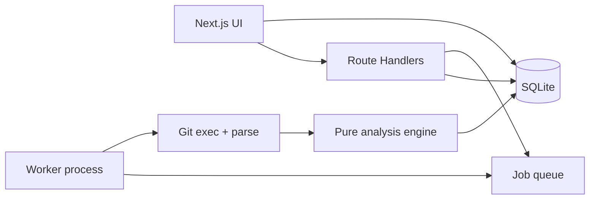

# GitChronicle

**Watch a codebase become itself.**

GitChronicle turns a Git repository into an interactive visual documentary and engineering-intelligence dashboard. Import a public GitHub URL, analyze a local repo, or open the bundled demo — then explore how the codebase evolved.

 

## Features

- **Overview** — age, commits, contributors, languages, heatmap, eras, milestones, narrative
- **Time Machine** — play / pause / scrub / step through sampled history with a living tree
- **Hotspots** — churn, ownership concentration, bus-factor, sortable risk tables
- **People** — profiles, hours, paths, languages, collaboration
- **Evolution** — growth, language mix, bursts, quiet periods, large commits
- **Graphs** — co-change and collaboration (capped for large repos)
- **Releases** — tags, categorized changes, downloadable Markdown notes
- **Story** — presentation deck + exportable repository report

## Sixty-second local setup

```bash
pnpm install
cp .env.example .env
pnpm db:migrate
pnpm seed
pnpm dev
```

Open [http://localhost:3000](http://localhost:3000) and click **Open bundled demo**.

No API keys or cloud accounts required.

## Docker

```bash
docker compose up --build
```

App: [http://localhost:3000](http://localhost:3000) · health: `/api/health`

## Ingestion

### 1. Bundled demo

Visit `/demo` or run `pnpm seed`. Uses a deterministic synthetic history so the UI works offline.

### 2. Public GitHub HTTPS URL

Paste `https://github.com/owner/repo` on the landing page. The server validates the host, clones with argument-array `git` (no shell interpolation), analyzes in a background job, and persists results to SQLite.

### 3. Local repository (self-host)

```bash
pnpm analyze -- /absolute/path/to/repo
```

Then open the printed `/repo/<slug>` path.

## Architecture



| Layer | Location |
| --- | --- |
| Git process execution | `src/lib/git/exec.ts`, `clone.ts` |
| Parsing | `src/lib/git/parse.ts` |
| Metrics | `src/lib/analysis/*` |
| Persistence | `src/lib/db/*` |
| Jobs | `src/lib/jobs/worker.ts` |
| UI | `src/app`, `src/components` |

## Analysis methodology

Metrics are **deterministic** from Git history:

| Metric | Method |
| --- | --- |
| Activity | Commit timestamps → day/week/month/hour/weekday histograms |
| Contributors | Author email identity; names collected as aliases |
| Churn | Sum of additions + deletions per path (`git log --numstat`) |
| Ownership / bus factor | Share of commits per path; people needed for ≥50% coverage |
| Co-change | Files appearing together in the same commit (capped) |
| Collaboration | Contributors sharing file ownership |
| Categories | Conventional Commits + keyword heuristics |
| Eras | Boundaries from version tags and activity structure |
| Timeline | Sampled snapshots for Time Machine playback |

## Security limitations

- Only **public HTTPS GitHub** URLs are accepted for remote clone
- No shell interpolation of user input
- Clones confined to `DATA_DIR/repos/<id>`
- Timeouts, size, commit, and graph caps apply
- Single-user self-host model — no auth multi-tenancy
- Do not expose an open import endpoint on the public internet without additional controls

## Scaling considerations

- Designed for single-instance self-hosting with SQLite
- Graph nodes/edges and timeline samples are capped
- Very large monorepos may hit `MAX_COMMITS` / size limits
- For multi-user SaaS you would need auth, queue isolation, and object storage — out of scope

## Commands

| Command | Purpose |
| --- | --- |
| `pnpm dev` | Development server |
| `pnpm build` / `pnpm start` | Production build / serve |
| `pnpm lint` | ESLint |
| `pnpm typecheck` | TypeScript |
| `pnpm test` | Vitest unit tests |
| `pnpm test:e2e` | Playwright |
| `pnpm db:migrate` | Apply SQLite schema |
| `pnpm seed` | Load bundled demo |
| `pnpm analyze -- <path>` | Analyze local repo |
| `pnpm worker` | Process background jobs |
| `pnpm cleanup` | Remove tmp / failed clones |

## Environment

See [`.env.example`](./.env.example). Important variables:

- `DATA_DIR` — SQLite, clones, caches
- `MAX_COMMITS`, `MAX_CLONE_SIZE_MB`, clone/analyze timeouts
- `MAX_GRAPH_NODES`, `MAX_GRAPH_EDGES`, `MAX_TIMELINE_SAMPLES`

## Contributing

See [CONTRIBUTING.md](./CONTRIBUTING.md).

## Roadmap

- [ ] Blame-aware ownership (optional, slower)
- [ ] Compare two analyses side-by-side
- [ ] Streaming progress via SSE
- [ ] Additional Git forges (with strict URL allowlists)
- [ ] Optional read-only GitHub App for private repos

## License

[MIT](./LICENSE)
